# 中州养老管理系统

一套面向养老机构的完整信息化解决方案，包含 **Web 管理后台**、**SpringBoot 后端服务** 与 **微信小程序家属端** 三端，支持多机构（多租户）隔离运营。

> 基于 RuoYi-Vue 3.8.8 二次开发，在其权限体系之上完成了养老业务全流程：来访登记 → 入住办理 → 在住服务 → 账单收款 → 退住结算，并延伸出 AI 健康报告、实时工作台与家属端在线缴费。


---

## 一、功能特性

### 1. Web 管理后台

| 模块 | 说明 |
|---|---|
| 工作台 | 6 类 KPI、入住趋势、老人分布、楼层入住率、待办、集团对比；支持拖拽个性化布局；WebSocket 30 秒实时推送 |
| 机构管理 | 多租户（机构）增删改查，数据按 `tenant_id` 自动隔离 |
| 老人档案 | 基本信息、健康记录、家属绑定、服务/账单/探访聚合视图 |
| 房间床位 | 房型、房间、床位三级管理，床位护理员分配 |
| 来访登记 | 预约登记、到访/离开状态流转 |
| 入住管理 | 7 步入住向导（选老人 → 选床位 → 评估 → 服务套餐 → 押金 → 确认），自动生成入住记录与床位占用 |
| 退住管理 | 7 步退住向导，结算未结账单、退还押金、释放床位 |
| 服务管理 | 服务项目、服务订单、护理任务派发与执行反馈 |
| 财务管理 | 月度账单生成、部分收款、收款记录、滞纳金自动计算、逾期识别、发票/收据打印、押金收退 |
| AI 健康报告 | 千帆大模型生成（可切 Mock 兜底），评分与风险分级、历史版本、Word/PDF 导出 |
| 消息通知 | 微信订阅消息推送（账单到期/逾期提醒），推送日志留痕 |
| 业务审计 | AOP 自动记录收款/退款等关键操作 |

### 2. 微信小程序（家属端）

- 手机号 + 验证码登录，一个账号可绑定多位老人并快速切换
- 首页概览：在住信息、待缴账单、健康评分、服务记录
- 账单中心：账单明细、逾期天数与滞纳金、**在线缴费**、收款记录
- 押金账户：余额与收退流水
- 健康报告：AI 报告列表与分段详情
- 服务记录：护理员执行反馈 + **服务评价**（四档满意度 + 文字，每单限评一次）
- 电子票据：按月渲染结算单，可复制账单信息
- 消息中心：账单到期 / 逾期 / 缴费成功通知
- 探访预约：发起与取消

---

## 二、技术栈

| 层次 | 技术选型 |
|---|---|
| 后端 | SpringBoot 2.5.15、Spring Security + JWT、MyBatis、Druid、Redis、Quartz、JSqlParser（多租户 SQL 改写）、WebSocket |
| 管理后台 | Vue 3、Element Plus、Vite、Pinia、Vue Router、ECharts、vuedraggable |
| 家属端 | Taro 4.1.9、React 18、TypeScript、Zustand、SCSS Modules |
| 数据库 | MySQL 8.0 |
| 文档导出 | Apache POI（Word）、iText（PDF）、html2canvas + jsPDF（前端 PDF） |
| 对象存储 | 本地磁盘（默认）/ 阿里云 OSS（可切换） |
| AI | 百度千帆大模型（可切换 Mock 模式离线演示） |

---

## 三、项目结构

```
zhongzhou-pension-system/
├── zhongzhou-backend/              后端 SpringBoot 工程
│   ├── ruoyi-admin/                启动模块、Controller（含 business 业务接口）
│   ├── ruoyi-framework/            安全、多租户拦截器、WebSocket
│   ├── ruoyi-system/               业务领域层（domain / mapper / service）
│   ├── ruoyi-common/               公共工具
│   ├── ruoyi-quartz/               定时任务
│   ├── ruoyi-generator/            代码生成器
│   ├── sql/                        数据库脚本（按编号顺序执行）
│   └── pom.xml
├── zhongzhou-ui/                   管理后台 Vue3 工程
│   └── src/views/business/         业务页面
├── zhongzhou-miniapp/              家属端 Taro 工程
│   └── src/pages/                  小程序页面
├── screenshots/                    运行截图
├── family-app-prototype.html       家属端交互原型（可直接浏览器打开）
├── start-all.ps1                   一键启动脚本（Windows）
├── PPT汇报方案.md                   汇报材料
└── 实训总结.md / .docx              项目总结
```

---

## 四、效果图

### 管理后台

| 工作台 | 老人档案 |
|---|---|
| 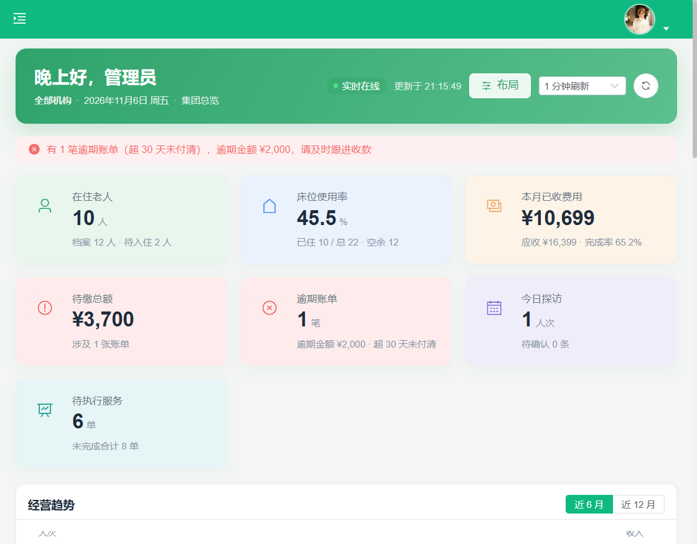 | 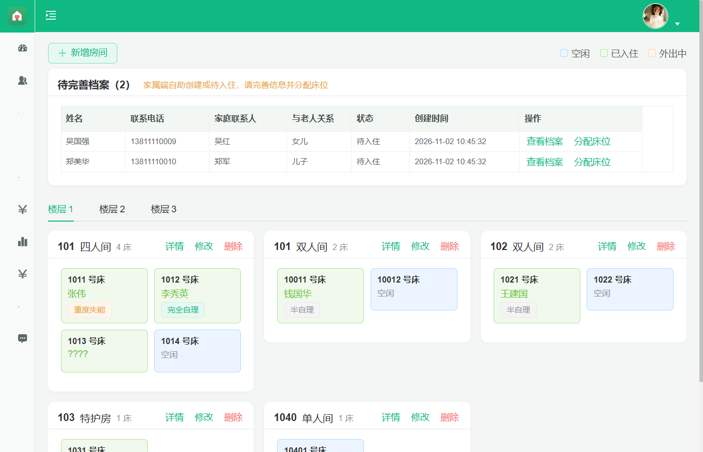 |

| 床位管理 | 入住向导 |
|---|---|
| 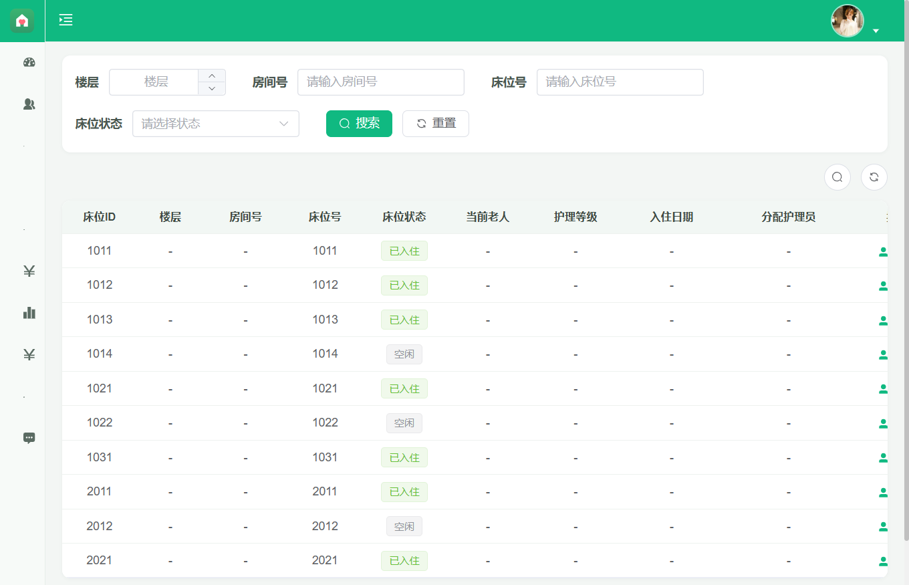 | 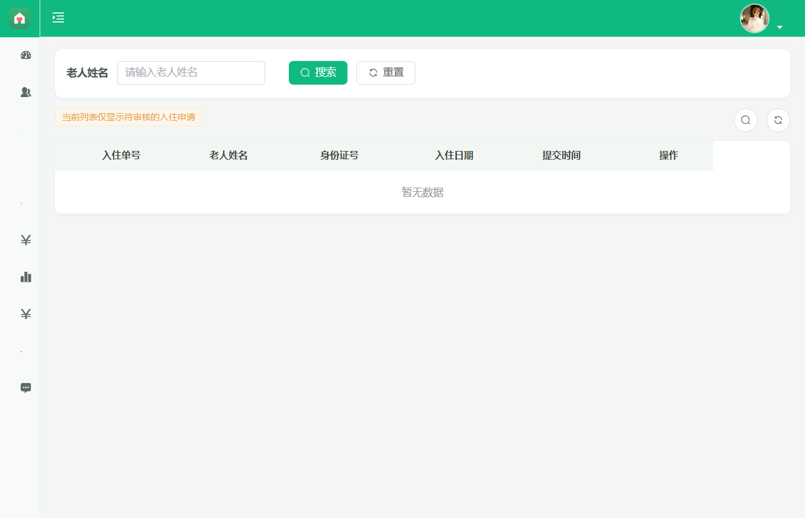 |

| 财务账单 | AI 健康报告 |
|---|---|
| 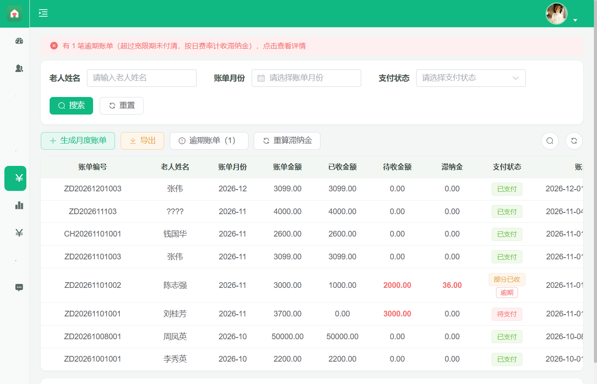 | 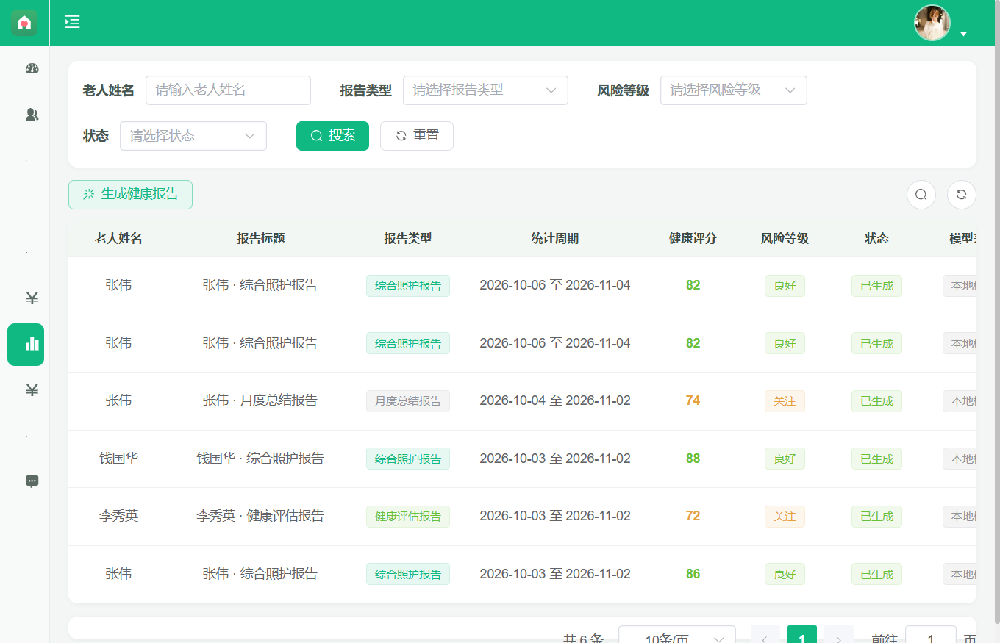 |

### 家属端小程序

| 登录 | 首页 | 服务记录 |
|---|---|---|
| 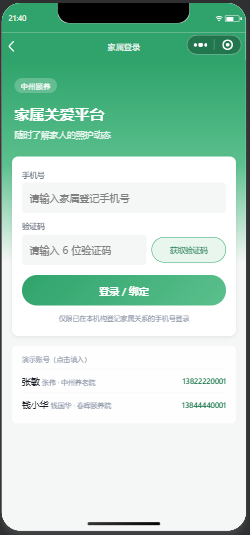 | 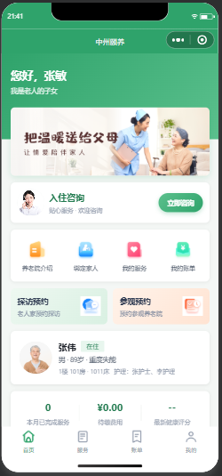 | 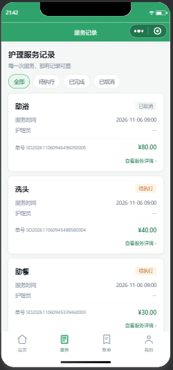 |

| 账单 | 健康报告 | 我的 |
|---|---|---|
| 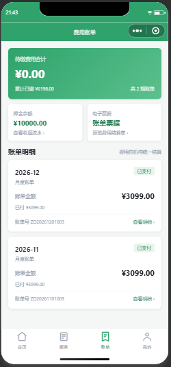 | 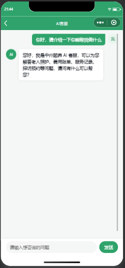 | 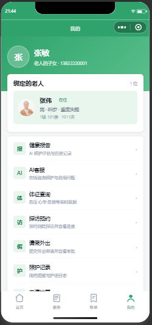 |

---

## 五、快速开始

### 1. 环境要求

| 依赖 | 版本 |
|---|---|
| JDK | 8 或 11 |
| Maven | 3.6+ |
| MySQL | 8.0 |
| Redis | 5.0+ |
| Node.js | 18+（小程序建议 20+） |
| npm | 9+ |

### 2. 初始化数据库

```bash
# 1) 创建数据库
mysql -uroot -p -e "CREATE DATABASE zhongzhou DEFAULT CHARACTER SET utf8mb4;"

# 2) 按顺序导入脚本
cd zhongzhou-backend/sql
mysql -uroot -p zhongzhou < ry_20240629.sql      # 若依基础表
mysql -uroot -p zhongzhou < quartz.sql           # 定时任务表
mysql -uroot -p zhongzhou < p1_tenant.sql        # 多租户
mysql -uroot -p zhongzhou < p2_business.sql      # 核心业务表 + 演示数据
mysql -uroot -p zhongzhou < p3_ai_report.sql
mysql -uroot -p zhongzhou < p4_family.sql
mysql -uroot -p zhongzhou < p5_dashboard_layout.sql
mysql -uroot -p zhongzhou < p6_payment_record.sql
mysql -uroot -p zhongzhou < p7_nurse_bed_menu.sql
mysql -uroot -p zhongzhou < p7_service_checkin.sql
mysql -uroot -p zhongzhou < p8_audit_log.sql
mysql -uroot -p zhongzhou < p8_health_record.sql
mysql -uroot -p zhongzhou < p8_service_task_audit_menu.sql
mysql -uroot -p zhongzhou < p9_service_task.sql
mysql -uroot -p zhongzhou < p11_deposit_penalty.sql
mysql -uroot -p zhongzhou < p12_archive_room_feedback.sql
mysql -uroot -p zhongzhou < p13_message_pay.sql
mysql -uroot -p zhongzhou < p14_fix_service_task_menu.sql
mysql -uroot -p zhongzhou < p15_service_evaluation.sql
mysql -uroot -p zhongzhou < p16_cleanup_orphan_binding.sql
mysql -uroot -p zhongzhou < p17_care_service.sql
mysql -uroot -p zhongzhou < p18_ai_chat.sql
```

> 脚本含双机构演示数据：`1 = 中州养老院`、`2 = 春晖颐养院`。

### 3. 启动 Redis

```bash
redis-server
# 默认 6379，无密码
```

### 4. 启动后端

修改 `zhongzhou-backend/ruoyi-admin/src/main/resources/application-druid.yml` 中的数据库账号密码，然后：

```bash
cd zhongzhou-backend
mvn clean package -DskipTests
java -jar ruoyi-admin/target/ruoyi-admin.jar
```

启动成功后接口地址：`http://localhost:8080`

### 5. 启动管理后台

```bash
cd zhongzhou-ui
npm install
npm run dev          # 开发模式，默认 http://localhost:80
# 或
npm run build:prod   # 生产构建，产物在 dist/
```

### 6. 启动家属端小程序

```bash
cd zhongzhou-miniapp
npm install
npm run dev:weapp    # 编译并监听，产物在 dist/
```

用**微信开发者工具**导入 `zhongzhou-miniapp` 目录（`project.config.json` 已配置 `miniprogramRoot: dist/`，AppID 可用测试号），并在「详情 → 本地设置」勾选 **不校验合法域名、web-view、TLS 版本以及 HTTPS 证书**（因默认请求 `http://localhost:8080`）。

不想用开发者工具时，可跑 H5 预览：

```bash
npm run dev:h5
```

### 7. 一键启动（Windows）

```powershell
powershell -ExecutionPolicy Bypass -File .\start-all.ps1
```

脚本会依次检查 MySQL / Redis / 后端 / 前端端口，启动缺失的服务并打印健康状态。

---

## 六、演示账号

### 管理后台

| 角色 | 账号 | 密码 | 说明 |
|---|---|---|---|
| 超级管理员 | `admin` | `admin123` | 集团视角，可查看全部机构数据 |
| 机构管理员 | `chunhui` | `admin123` | 春晖颐养院，只能看到本机构数据 |

### 家属端小程序

| 姓名 | 手机号 | 绑定老人 | 机构 |
|---|---|---|---|
| 张敏 | `13822220001` | 张伟（101 房 1011 床） | 中州养老院 |
| 钱小华 | `13844440001` | 钱国华 | 春晖颐养院 |

> 演示环境验证码会在登录页直接展示；生产环境需接入短信服务商。

---

## 七、关键配置

| 配置项 | 位置 | 说明 |
|---|---|---|
| 数据库连接 | `ruoyi-admin/src/main/resources/application-druid.yml` | `url` / `username` / `password` |
| Redis | `application.yml` → `spring.redis` | 默认 `localhost:6379` |
| 日志路径 | `logback.xml` → `log.path` | 默认 `D:/sxunkaifa/xitongkaifa/logs` |
| AI 报告 | `application.yml` → `ai.report` | `mock=true` 时无需外部服务即可演示 |
| 文件存储 | `application.yml` → `report.storage` | `local` 或 `oss` |
| PDF 中文字体 | `application.yml` → `report.font.path` | Windows/Linux 路径可切换 |
| 微信小程序 | `application.yml` → `wx.miniapp` | `enabled=false` 时走 Mock；生产需配置 AppID/Secret/模板 ID |
| 滞纳金 | `application.yml` → `bill.overdue` | 宽限天数、日费率 |
| 前端接口地址 | `zhongzhou-ui/.env.development` | `VITE_APP_BASE_API=/dev-api`，代理到 8080 |
| 小程序接口地址 | `zhongzhou-miniapp/src/services/request.ts` | `BASE_URL`，真机需换备案 https 域名 |

---

## 八、接口概览

| 前缀 | 说明 | 鉴权 |
|---|---|---|
| `/system/**` | 用户、角色、菜单、部门、机构 | JWT（`Authorization: Bearer`） |
| `/business/**` | 老人、房间、入住、服务、账单、押金、报告、工作台 | JWT |
| `/family/**` | 家属端登录、老人、账单、押金、报告、探访、评价 | `X-Family-Token` |
| `/ws/dashboard` | 工作台实时推送 | 查询参数 `?token=` |

家属端主要接口：

```
POST /family/auth/sendCode          发送验证码
POST /family/auth/login             登录（返回 X-Family-Token）
GET  /family/elders                 绑定老人列表
GET  /family/services               服务记录
GET  /family/bills                  账单列表
GET  /family/bills/{billId}         账单详情
POST /family/bills/{billId}/pay     在线缴费
GET  /family/deposits               押金余额与流水
GET  /family/reports                健康报告
GET  /family/messages               消息通知
GET  /family/services/{orderId}/evaluation   查询评价
POST /family/services/{orderId}/evaluation   提交评价
```

---

## 九、多租户设计

- 机构表 `sys_tenant`，业务表统一带 `tenant_id`；
- `TenantSqlInterceptor` 基于 JSqlParser 在 SQL 层改写 `SELECT / UPDATE / DELETE`，自动追加租户条件；
- 新增数据通过 `SecurityUtils.getTenantId()` 自动归属当前机构；
- 超级管理员（`user_id = 1`）豁免隔离，呈现集团视角；
- 家属端无若依登录上下文，所有 SQL 显式传 `tenant_id` 并校验家属与老人的绑定关系。

---

## 十、常见问题

**启动报错找不到日志目录**
`logback.xml` 的 `log.path` 需指向真实可写目录，Windows 下 `/home/ruoyi/logs` 会被解析到 `D:\home`。

**登录一直提示验证码错误**
Redis 未启动或验证码缓存未清理。可临时将 `sys_config` 中 `sys.account.captchaEnabled` 置为 `false`，并删除 `sys_config:sys.account.captchaEnabled` 缓存。

**小程序请求失败**
确认后端 8080 已启动；微信开发者工具需关闭域名校验；真机调试需将 `BASE_URL` 换成已备案的 https 域名。

**小程序模拟器启动失败 / app.json 不是合法 JSON**
`dist/app.json` 带有 UTF-8 BOM 时会报错，需保证为无 BOM 的 UTF-8。

**页面空白但菜单正常**
菜单配置的 `component` 路径与前端文件不一致，或对应接口未实现。检查 Network 中的失败请求。

---

## 十一、相关文档

- [PPT汇报方案.md](PPT汇报方案.md)
- [实训总结.md](实训总结.md)
- [家属端交互原型](family-app-prototype.html)（浏览器直接打开）
- 数据库脚本：[zhongzhou-backend/sql](zhongzhou-backend/sql)

---

## 十二、许可

本项目基于 [RuoYi-Vue](https://gitee.com/y_project/RuoYi-Vue) 二次开发，遵循 [MIT](LICENSE) 许可协议。

演示数据中的人物、手机号均为虚构，仅用于功能展示。
